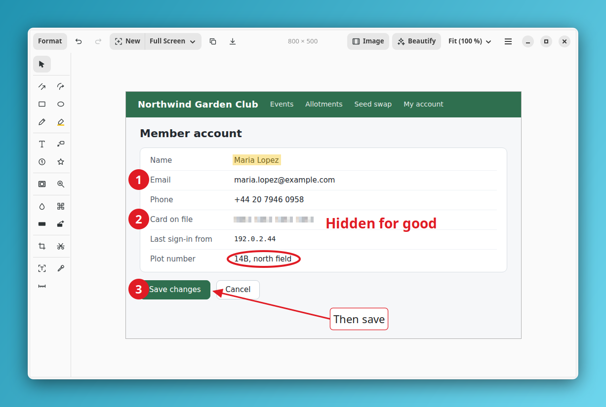
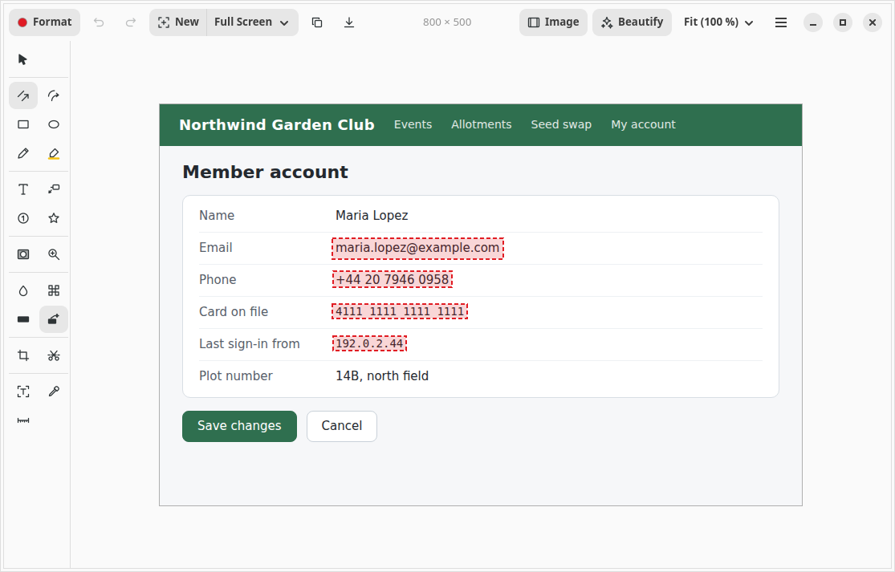
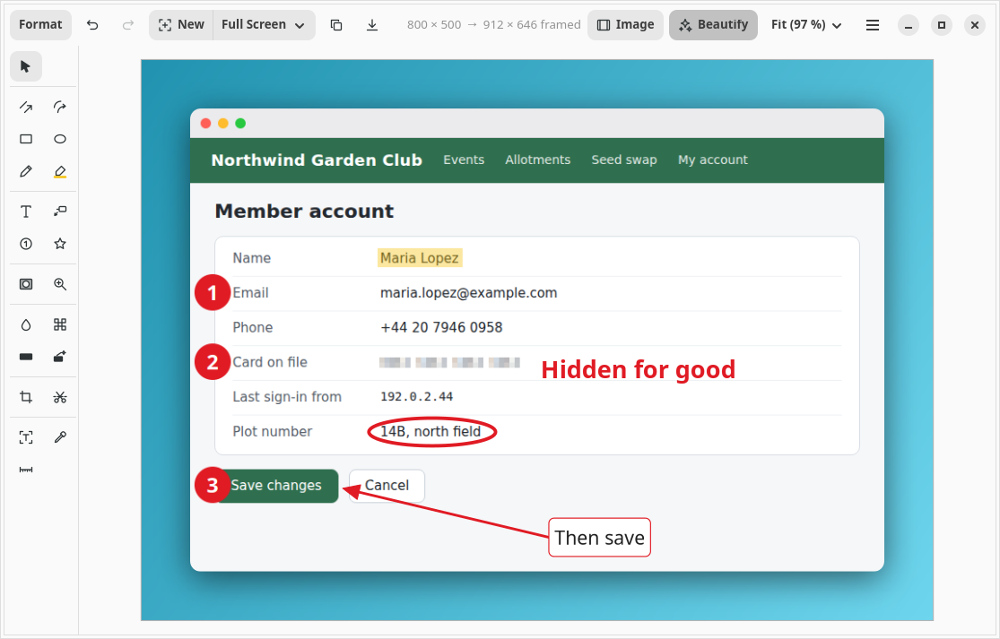
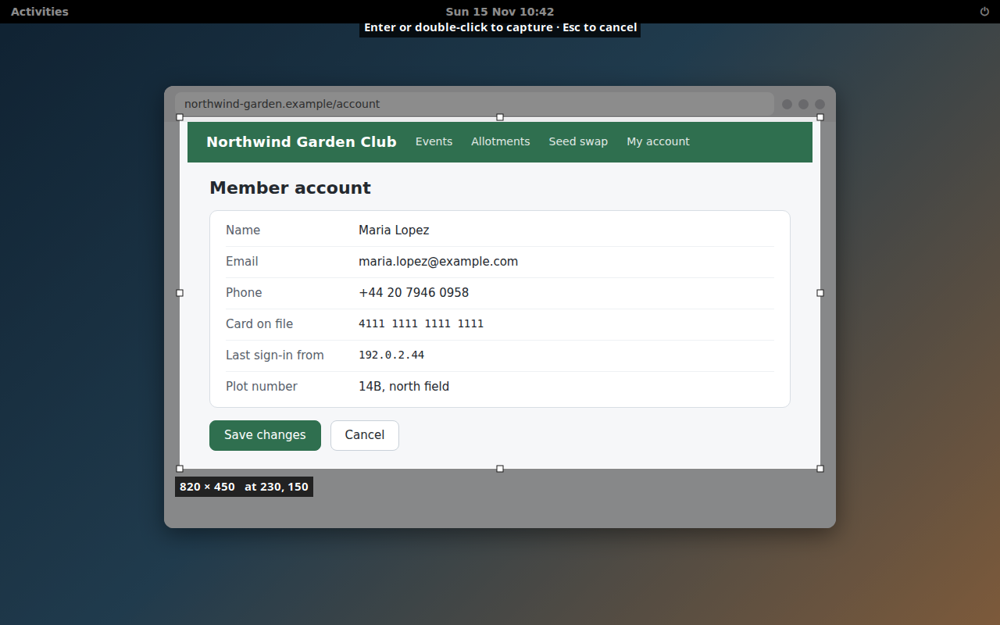
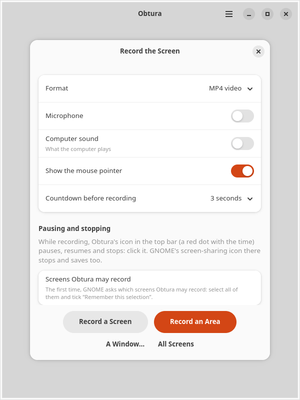

<h1 align="center">Obtura</h1>

<p align="center"><b>Capture, annotate, redact and record your screen on Ubuntu.</b><br>
A fast screenshot tool with an editor that needs no manual, for the GNOME desktop,
and for Windows 10 and 11. Free and open source.</p>



*The picture above was annotated and framed with Obtura itself. The account page in the
pictures is made up.*

## What Obtura does

- **Capture** a region or the whole screen, the same region again, after a delay, or a
  **whole page that scrolls**. No white flash: the screen stands still while you choose,
  and the picture is on the clipboard the moment it is taken.
- **Annotate**: arrows and curves through as many points as you like, rectangles,
  ellipses, pen, highlighter, text and callouts typed on the picture in any installed
  font, numbered steps, emoji and symbols, magnifier, spotlight, measure. Every mark stays
  editable until you save, with handles, a round handle to turn it, alignment guides and
  a style per tool.
- **Redact for real**: blur, pixelate or cover with a box; the hidden pixels are gone from
  the saved file. **Smart Redact** finds email addresses, phone and card numbers, IBANs,
  IP addresses, keys, passwords and QR codes for you.
- **Beautify**: gradient backgrounds or a picture of your own, padding, rounded corners,
  shadow, window bar, phone, tablet, laptop and monitor frames, torn edge, size ratios for
  posts and slides; your own frame on every capture if you like.
- **Edit the picture**: crop (with ratios), rotate, flip, resize, add space, trim borders,
  cut out a strip, combine several pictures in a row, a column or a grid, paste pictures
  or text.
- **Text, QR codes and colour**: copy the text of a picture or of any part of the screen
  (OCR, on your computer), read QR codes, pick a colour anywhere (hex, rgb() or hsl()),
  measure the screen in pixels.
- **Record** the screen, an area, a window or all your screens as MP4, WebM or GIF, with
  microphone and computer sound (and level meters); pause, resume and stop from Obtura's
  icon in the top bar; trim afterwards.
- **Pin** a picture on the screen; a **library** of every capture, searchable by the
  words in it and by your own tags.
- **Command line** for scripts and keyboard shortcuts: `obtura --region`, `--screen`,
  `--scroll`, `--copy`, `--save`, `--ocr`, `--qr`, `--pick-color`, `--measure`,
  `--record`, with exit codes.

**Private by design**: Obtura works entirely on your computer. It does not connect to the
internet, has no account and collects nothing.

| Smart Redact | Beautify |
| --- | --- |
|  |  |
| **Choosing a region** | **Recording** |
|  |  |

## Install

Obtura runs on **Ubuntu 24.04 LTS and newer** with the GNOME desktop, on 64-bit Intel and
AMD computers. Download `obtura_0.9.1-1_amd64.deb` from the
[releases page](https://github.com/Romi-iubh/obtura/releases/latest), then in a Terminal:

```
sudo apt install ~/Downloads/obtura_0.9.1-1_amd64.deb
```

apt also installs the programs Obtura uses for recording (GStreamer) and for reading
text (Tesseract). For keys that work in every app (**Super+Shift+S** for a region),
click **Use Super+Shift+S in Every App** in Obtura's start window. The
[user guide](docs/user-guide.md) (also **F1** in Obtura) explains everything.

### Windows

Obtura also runs on **Windows 10 and 11** (64-bit): download `Obtura-0.9.1-setup.exe`
and run it (installed for you only, no administrator rights needed), or unpack
`Obtura-0.9.1-windows-x64.zip` and run `Obtura\bin\obtura.exe`. **Print Screen**
captures a region from any app, and Obtura's icon by the clock offers the other
captures. Screen recording is not in the Windows version yet. See
[Obtura on Windows](docs/user-guide.md#18-obtura-on-windows) in the guide.

## Building from source

Rust 1.85 or newer, and the GTK 4 and libadwaita development files:

```
sudo apt install build-essential pkg-config libgtk-4-dev libadwaita-1-dev
cargo run -p obtura
```

`scripts/check.sh`, `scripts/test.sh` and `scripts/smoke.sh` check, test and try it
headless; [docs/RELEASING.md](docs/RELEASING.md) makes the package.
`packaging/windows/build-exe.sh` cross-compiles the Windows version in Docker (GTK from
MSYS2, llvm-mingw) and `packaging/windows/test-exe.sh` tries it under Wine.

## Licence

Copyright © 2026 Rosaire. Obtura is free software under the
[GNU Affero General Public License, version 3 or later](LICENSE).
