# Obtura User Guide

*Version 0.9 · for Ubuntu 24.04 LTS and newer, and Windows 10 and 11*

Obtura takes screenshots and records the screen on the GNOME desktop. It also runs on
Windows 10 and 11: if you use Windows, read [Obtura on Windows](#18-obtura-on-windows)
first. Its editor opens
right after a capture: point things out with arrows, text and numbered steps, hide what
should stay private, frame the picture, and paste it anywhere. It also captures long
pages that scroll, reads the text and the QR codes in a picture, picks colours, measures
the screen, pins pictures on the screen and keeps a library of every capture.

Everything happens on your computer. Obtura does not connect to the internet, has no
account and sends nothing anywhere.

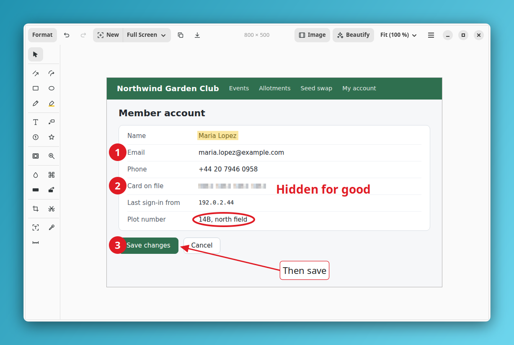

## Contents

1. [Installing Obtura](#1-installing-obtura)
2. [Getting started](#2-getting-started)
3. [Taking screenshots](#3-taking-screenshots)
4. [The editor](#4-the-editor)
5. [Hiding private information](#5-hiding-private-information)
6. [Changing the picture](#6-changing-the-picture)
7. [Beautify](#7-beautify)
8. [Text, QR codes, colours and measuring](#8-text-qr-codes-colours-and-measuring)
9. [Copying, saving and pinning](#9-copying-saving-and-pinning)
10. [Recording the screen](#10-recording-the-screen)
11. [The library](#11-the-library)
12. [The command line](#12-the-command-line)
13. [Preferences](#13-preferences)
14. [Keyboard shortcuts](#14-keyboard-shortcuts)
15. [Troubleshooting](#15-troubleshooting)
16. [Your data and privacy](#16-your-data-and-privacy)
17. [Licence and credits](#17-licence-and-credits)
18. [Obtura on Windows](#18-obtura-on-windows)

---

## 1. Installing Obtura

### What you need

- Ubuntu 24.04 LTS, 26.04 LTS or any newer release with the GNOME desktop, on a
  64-bit Intel or AMD computer.
- About 5 MB of disk space for Obtura itself. apt adds the helper programs for
  recording and text recognition if they are missing; it shows the exact amount
  before it installs anything.

### Download

Open the [Obtura releases page](https://github.com/Romi-iubh/obtura/releases/latest)
and download the file whose name ends in `_amd64.deb`, for example
`obtura_0.9.1-1_amd64.deb`. It goes to your **Downloads** folder.

### Install with the Terminal (recommended)

This way also installs the helper programs Obtura uses for recording (GStreamer) and
for reading text (Tesseract).

1. Open **Terminal** (press **Ctrl+Alt+T**).
2. Type the line below and press **Enter**:

   ```
   sudo apt install ~/Downloads/obtura_0.9.1-1_amd64.deb
   ```

3. Type your password when asked (nothing shows while you type) and press **Enter**.
   Answer **Y** if apt asks whether to continue.

### Install with App Center

In the **Files** app, right-click the downloaded file, choose **Open With… ›
App Center**, then **Install**. App Center may warn that the package does not come
from Ubuntu: that is expected for programs downloaded from their own website.
App Center may leave out the helper programs; if Obtura later says that recording
or text reading needs a program, install it as shown in
[Troubleshooting](#15-troubleshooting).

### Start Obtura

Press the **Super** key (the Windows key), type **Obtura** and press **Enter**. To keep
it in the dock, right-click its icon there and choose **Pin to Dash**. Right-click the
icon in the dock for **Capture a Region**, **Capture the Screen**, **Copy Text from the
Screen** and **Library**.

### Update

Download the new `.deb` and install it the same way. Your settings, your library and
your saved pictures are kept.

### Remove

```
sudo apt remove obtura
```

Your settings and your library stay in your home folder (see
[Your data and privacy](#16-your-data-and-privacy)) in case you install Obtura again.

---

## 2. Getting started

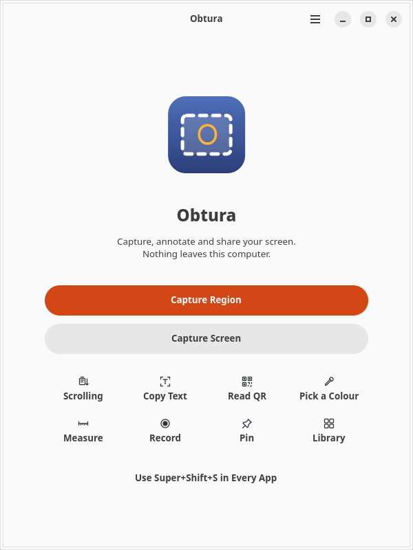

The start window has the two captures you will use most, **Capture Region** and
**Capture Screen**, and below them **Copy Text**, **Pick a Colour**, **Record**,
**Pin** and **Library**. Once you have chosen a region, **Same Region Again** appears
too. The menu (**☰**) holds Preferences, Keyboard Shortcuts, the User Guide (**F1**)
and About.

### Your first screenshot

1. Click **Capture Region** (or press **Ctrl+Shift+R** in any Obtura window).
2. Drag over the part of the screen you want.
3. Press **Enter**.

The picture is now on the clipboard, ready to paste into a chat, an e-mail or a
document, and Obtura's editor is open on it.

### What GNOME asks the first time

GNOME asks two questions once, the first time they are needed:

- **Which screens Obtura may see** (the first region capture). Obtura looks at the
  screen the way screen sharing does, which avoids GNOME's white flash. **Select every
  screen**, tick **Remember this selection** and click **Share**. GNOME then shows its
  screen-sharing icon in the top bar for a few seconds after each screenshot; that is
  normal. You can change the screens later in **Preferences › Screens Obtura may see ›
  Choose Again**.
- **Whether Obtura may take screenshots** (the first **Capture Screen** or **Same Region
  Again**). Obtura says so in its window: click **Continue**, then **Allow** in GNOME's
  question. If you clicked **Deny** by mistake, Obtura offers **Ask Again** the next
  time.

### Keys that work in every app

Obtura's own keys (**Ctrl+Shift+R** and the others) work while an Obtura window is in
front. For keys that work everywhere, even when Obtura is closed, click **Use
Super+Shift+S in Every App** at the bottom of the start window, or turn on
**Preferences › Keys in every app**:

| Key | Does |
| --- | --- |
| **Super+Shift+S** | Capture a region |
| **Super+Shift+T** | Copy the text of a region |
| **Super+Shift+R** | Start or stop recording an area |

(**Super** is the key with the Windows logo.) Obtura adds them to GNOME's own keyboard
shortcuts, where you can change the keys: **Settings › Keyboard › View and Customize
Shortcuts › Custom Shortcuts**. A key that something else already uses is left out.
**Preferences › Other keys** lists more commands, each with a copy button, to give them
a key of your own the same way.

---

## 3. Taking screenshots

### A region

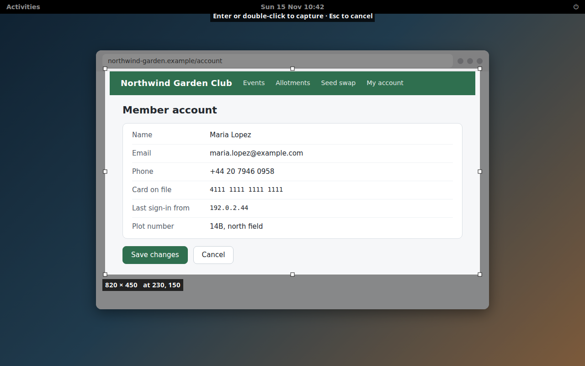

The screen stands still while you choose: Obtura shows a picture of it, taken the
moment the capture started.

| To | Do |
| --- | --- |
| Select | Drag over the part you want |
| Take the picture | **Enter** or double-click |
| Move the selection | Drag inside it, or the **arrow keys** (one pixel at a time) |
| Resize | Drag a handle, or **Shift+arrow keys** |
| Cancel | **Escape** or right-click |

The size and position of the selection show below it. The overlay proposes the region
you chose last time: **Enter** takes it again, a drag starts a new one. If you have
several screens, a selection can cross from one to the other. A screen that GNOME does
not share with Obtura looks dark; press **S** to choose again which screens to share.

### The whole screen

**Capture Screen** (**Ctrl+Shift+F**) takes every screen at once. GNOME flashes the
screen at that moment.

### A window

**A Window** beside the editor's **New** button, or `obtura --window`: GNOME lists the open
windows; pick one and its picture opens in the editor, without what is around or above
it.

### The same region again

**Same Region Again** (start window, **Ctrl+Shift+N** in the editor, or
`obtura --last-region`) takes the region chosen last time without asking. Handy to take
the same part of a page before and after a change.

### A long page (scrolling capture)

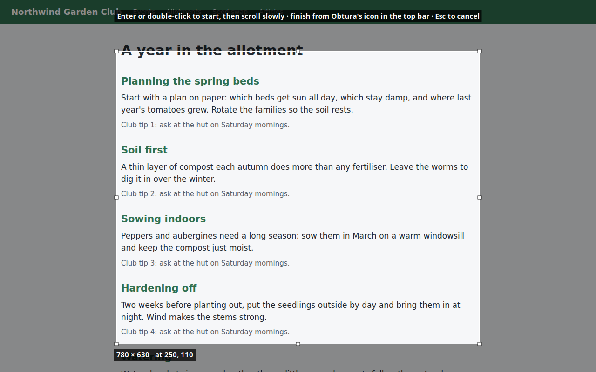

For a web page, a document or a chat longer than the screen: **Scrolling** in the start
window, **Scrolling** beside the editor's **New** button, or `obtura --scroll`.

1. Drag over the part that scrolls (leave out the scroll bar for a cleaner picture), then
   press **Enter**.
2. Scroll it with the mouse wheel, from the top down, one notch at a time or a little
   faster. Obtura joins what comes into view. Its icon in the top bar shows how tall the
   picture is. Obtura's own windows step aside meanwhile, so the wheel and the keys reach
   the page.
3. Click Obtura's icon in the top bar and choose **Finish Scrolling Capture** (or open
   Obtura again, or run `obtura --scroll` again). The picture opens in the editor; started
   from an editor's **New** button, it takes that editor's place.

A header that stays at the top of the page while it scrolls (a menu bar, a title) is kept
once, at the top. Scrolling back up above where you started adds that part too. Things
that change while the page scrolls (a row lit up under the pointer, a picture that loads,
the scroll bar) do not stop the joining. If the icon says **Too fast: scroll back up a
little**, two views did not overlap: scroll back up until it shows the height again, then
go on more slowly.
**Cancel** in the same menu gives up. Obtura only watches the screen: it never scrolls or
moves the pointer by itself. A capture stops by itself after five minutes, or at
40 000 pixels.

### With a menu open, or after a delay

Open the menu, then press **Super+Shift+S** (see [Keys that work in every
app](#keys-that-work-in-every-app)): the menu is in the picture. Or take the picture
after a delay: beside the editor's **New** button, **Region in 3 s**, **5 s** or **10 s**, or
**Full Screen in 5 s**; from the command line, for example `obtura --region --delay 5`.
The seconds left show beside Obtura's icon in the top bar, whose menu has **Take the
Screenshot Now** and **Cancel**. See [The command line](#12-the-command-line).

### From the editor

The **New** button in the editor's header (**Ctrl+N**) takes a new picture in place of
this one. The box beside it says what it takes, and is where you change it: **Region**,
**Same Region**, **Full Screen**, **A Window**, **Scrolling**, or a region or the full
screen after a delay. New remembers: after a capture, it takes the same kind again (a
scrolling capture, then another scrolling capture), until you choose something else.
**Ctrl+Shift+N** always takes the same region again. If the picture has marks you have
not saved, Obtura asks first. Other editor windows stay open, where you left them.
Recording is in the main menu (**☰ › Record the Screen…**).

---

## 4. The editor

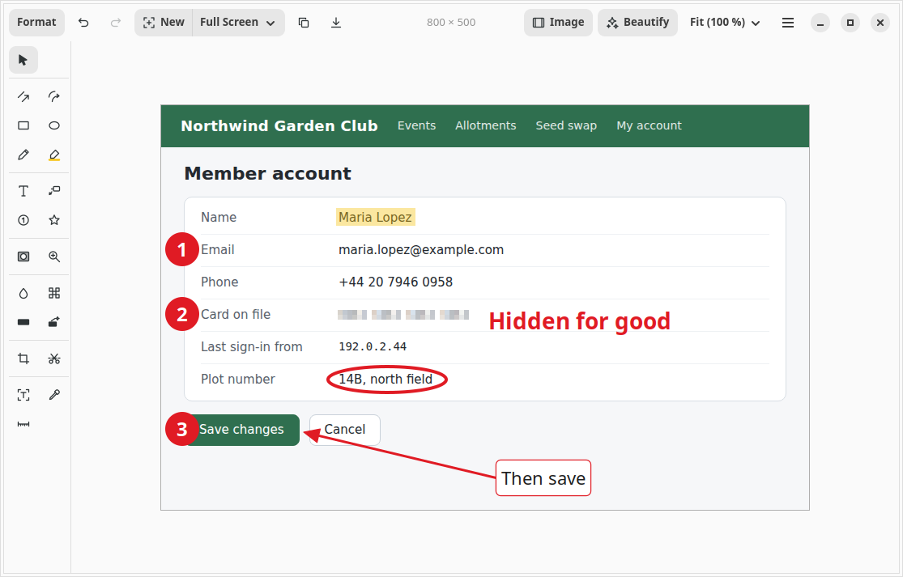

| Area | What it holds |
| --- | --- |
| **Header** (left) | **Format**, Undo, Redo, **New** and what it takes, Copy, Save |
| **Header** (middle) | The size of the picture, and of the result when marks or a frame make it bigger |
| **Header** (right) | **Image** menu, **Beautify**, zoom, main menu (**☰**) |
| **Tool column** (left) | Every tool, in groups; hold the pointer over one to see its name and key |
| **Picture** | Where you draw |

### Tools

Press a tool's letter, or click it. A tool stays active until you choose another or
press **Escape**.

| Tool | Key | What it does |
| --- | --- | --- |
| Select and Move | **V** | Click a mark to select it; drag to move it, its handles to resize it |
| Line and Arrow | **L** | A straight line, with an arrow head at its end; **Shift** keeps it at 45° steps |
| Curved Line and Arrow | **S** | The same, bent through its middle handle (add more bends: see below) |
| Rectangle | **R** | **Shift** draws a square |
| Ellipse | **E** | **Shift** draws a circle |
| Pen | **P** | Freehand |
| Highlighter | **H** | A see-through marker over text |
| Text | **T** | Click and type; **Enter** ends, **Shift+Enter** starts a new line |
| Callout | **K** | Press on what it points at, drag to where the box goes, type |
| Numbered Step | **N** | Click: badges number themselves 1, 2, 3… |
| Emoji and Symbols | **M** | Choose one in Format, then click |
| Spotlight | **D** | Dims everything outside the area you drag |
| Magnifier | **Z** | Drag over a detail: a lens shows it twice as big beside it |
| Blur, Pixelate, Box | **B**, **X**, **O** | Hide what is under them, for good (see [section 5](#5-hiding-private-information)) |
| Smart Redact | **Ctrl+Shift+X** | Finds private information and hides it |
| Crop | **C** | Drag the part to keep, then **Enter** |
| Cut Out a Strip | **U** | Removes a band across the picture and joins the rest |
| Copy Text | **G** | Drag over text to copy it; a click copies all of it |
| Colour Picker | **I** | Click to copy a colour |
| Measure | **Q** | A dimension line with its length in pixels |

### Changing a mark

Every mark stays a separate object until you save: select it with **V** (or just after
drawing it, while its handles show) to move it, resize it by its handles, change its
look or delete it (**Delete**). Lines have a handle at each end, curves one in the
middle, callouts one on the tip and on the box. Text, badges and emoji grow from their
corners.

- **Turn a mark**: drag the round handle above it. Hold **Shift** to turn in steps of
  15°; double-click the round handle to stand the mark upright again. Shapes, text,
  badges, emoji, pictures and pen strokes turn (blurs and boxes stay upright).
- **Bend a line through several points**: with **V**, double-click a line or a curve
  where it should bend; a round handle appears there, drag it. Each bend is a round
  handle; double-click one to remove it. The line passes smoothly through every bend.
- **Paste text** (**Ctrl+V**): text on the clipboard becomes a text box where the
  pointer is, ready to move and restyle.

While you move a mark, magenta guide lines show when it lines up with the picture's edges
or centre, or with another mark, and the mark snaps to them. Hold **Alt** to move it
freely.

### Format

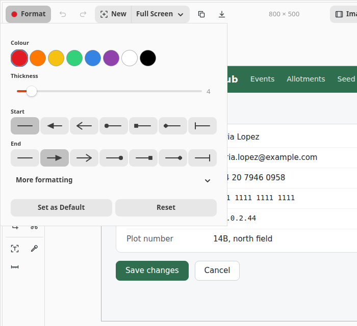

**Format** (**F**) shows the options of the current tool, or of the selected mark: the
colour, the thickness or size, and what matters for that tool (line ends, filled shapes,
badge shapes, the round or square shape of a blur). **More formatting** opens the rest:
other colours (with a full colour chooser), font, dashes, corners, background and
border of text boxes, how see-through the mark is. The font list has Sans, Serif,
Monospace and Handwriting; **Other Font…** (or the pencil beside the list) chooses any
font installed on the computer.

A change applies to the selected mark and becomes the tool's style for the next marks.
**Set as Default** keeps that style for the tool from then on, also after a restart;
**Reset** goes back to Obtura's style.

### Undo, zoom, room around the picture

- **Ctrl+Z** undoes, **Ctrl+Shift+Z** redoes, as far back as the picture was opened.
- **Ctrl+wheel** zooms around the pointer; **Ctrl+0** fits the window, **Ctrl+1** shows
  the picture at its real size. The wheel scrolls, **Shift+wheel** scrolls sideways, the
  middle mouse button drags the view. The zoom button in the header does the same.
- A mark may go past the edge of the screenshot: the picture then grows with white room
  to hold it, and the header shows the new size. Move or delete the mark and the room
  goes again.

---

## 5. Hiding private information

### Blur, pixelate, box

Drag over what should not be seen. **Blur** (**B**) and **Pixelate** (**X**) keep the
colours and hide the details; **Box** (**O**) covers it completely. In **Format**,
choose a **rectangle** or an **ellipse**, and for blur and pixelate the **strength**.

These marks really destroy what is under them in the saved and copied picture: the
details are not hidden under a layer, they are gone from the file and cannot be brought
back. A blur also hides the marks below it.

### Smart Redact

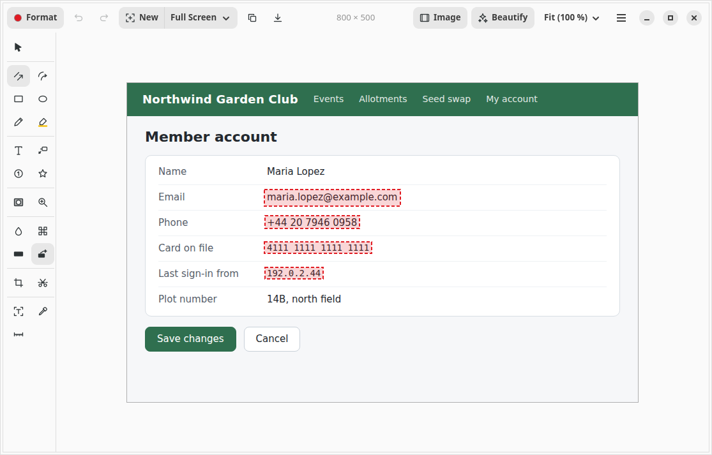

**Smart Redact** (the button beside **Box** in the tool column, **Ctrl+Shift+X**, or the
main menu) reads the text of the picture and finds:

- email addresses, phone numbers, card numbers, IBANs,
- IP addresses, keys and tokens (long random-looking words, known key formats),
- passwords written as *password: …* or *token=…*,
- QR codes (they can hold a Wi-Fi password, a login secret or a ticket): the whole code
  is covered.

They are outlined on the picture and listed with a tick each. Untick what may stay, choose
**Box**, **Blur** or **Pixelate**, and click **Hide**. It is one step: **Ctrl+Z** undoes
it. Smart Redact needs the Tesseract program (installed with Obtura from the Terminal).
Check the result: text that is very small, blurry or on a busy background may be missed.

> The library keeps each screenshot as it was taken, before anything was hidden, so
> that you can edit it again. See [The library](#11-the-library).

---

## 6. Changing the picture

### Crop and cut out

- **Crop** (**C**): drag the part to keep, adjust it by its handles, press **Enter**. In
  **Format**, choose a shape: Free, 16:9, 4:3, 3:2, 1:1 or 9:16. Marks entirely outside
  the part kept are removed.
- **Cut Out a Strip** (**U**): drag across a band of the picture, for example the empty
  middle of a long page. The band is removed and the two parts joined. Drag more down
  than across to remove rows, more across than down to remove columns.

### The Image menu

| Command | What it does |
| --- | --- |
| **Rotate Left / Right** (**Ctrl+[** / **Ctrl+]**) | Turns the picture a quarter turn; marks turn with it |
| **Flip Left to Right / Upside Down** | Mirrors the picture |
| **Resize…** (**Ctrl+Alt+R**) | A new size in pixels, proportions kept; marks scale too |
| **Add Space Around…** | Room on each side, in a colour you choose |
| **Trim Plain Borders** | Removes plain edges around the picture |
| **Combine with Several Pictures…** | Choose several pictures at once (Ctrl+click): they go with this one in a row, a column or a grid, with the space between, how they line up and the background colour you choose |
| **Attach a Picture on the Right… / Below…** | Puts another picture beside or below this one |
| **Place a Picture on Top…** | Adds a picture as a mark you can move and resize |
| **Paste a Picture or Text** (**Ctrl+V**) | The same, from the clipboard; text becomes a text box |

---

## 7. Beautify

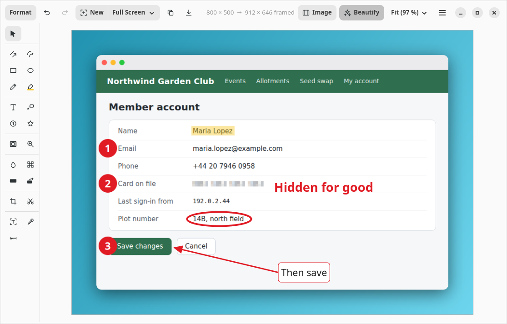

**Beautify** (**Shift+B**) puts the picture on a background, ready for a presentation,
a social post or documentation. Turn on **Frame around the picture**, then choose:

- **Background**: six gradients, white, light grey, dark, transparent, your own
  colours (top-left and bottom-right), or a **Picture** of your own (**Choose…**): it
  covers the whole background, cut to fit, never stretched.
- **Space around**, **Rounded corners**, **Shadow**, **Border** and its colour.
- **Window bar**: none, light, dark, or a browser bar with three round buttons.
- **Device**: the picture on the screen of a **Phone**, a **Tablet**, a **Laptop** or a
  **Monitor**, drawn around it.
- **Torn bottom edge**, like a strip of paper (not with a device).
- **Size ratio**: free, 16:9, 4:3, 1:1, 4:5, 9:16 or 3:2; the background fills the rest.

The header shows the size of the framed result. The frame is part of the picture's
history: **Ctrl+Z** undoes a change.

**Save as My Frame** keeps the current frame; **Use My Frame** puts it on another
picture; **Add my frame to every new capture** does that by itself.

---

## 8. Text, QR codes, colours and measuring

### Copy the text of a picture

- In the editor, the **Copy Text** tool (**G**): drag over the text you want, or click
  once for all the text of the picture. **Ctrl+Shift+C** copies all of it at once.
- Straight from the screen: **Copy Text** in the start window (**Ctrl+Shift+T**), or
  `obtura --ocr`. Choose a region; its text goes to the clipboard.

A message shows what was copied. The text is read on your computer by Tesseract. It
never includes what was blurred, pixelated or boxed. To read other languages, see
[Preferences](#13-preferences).

### Read QR codes

- In the editor: **Read QR Codes** in the main menu (**Ctrl+Shift+Q**). One code: what
  it holds is copied at once (a link can be opened from the message). Several: a window
  lists them, each with **Copy** (and **Open Link** for a link).
- Straight from the screen: **Read QR** in the start window, or `obtura --qr`. Choose a
  region; what its codes hold goes to the clipboard.

Codes are read on your computer. A link is opened only when you click **Open Link**,
after seeing it. Codes that were blurred, pixelated or boxed are never read.

### Pick a colour

- In the editor, the **Colour Picker** (**I**): a magnifying loupe follows the pointer
  with the colour's code; a click copies it.
- Anywhere on the screen: **Pick a Colour** in the start window, or
  `obtura --pick-color`.

The colour is copied as `#rrggbb`; **Preferences › Colour picker** can copy it as
`rgb(…)` or `hsl(…)` instead, for CSS.

### Measure

- In the editor, the **Measure** tool (**Q**) draws a dimension line with its length in
  pixels. Hold **Shift** to keep it horizontal, vertical or at 45°.
- On the screen: **Measure** in the start window, or `obtura --measure`. Drag across
  what you want to measure: the length, the width and height, and the angle show beside
  it (**Shift**: straight lines). Drag again to measure something else; **Enter** copies
  the measurement (for example *300 × 150 px, 335 px long at 333°*), **Escape** closes.

While choosing a region, the size of the selection shows below it.

---

## 9. Copying, saving and pinning

### Copy

After a capture the picture is on the clipboard at once. When you go to another window
after adding marks, Obtura puts the marked-up picture there instead, so the paste is
always what you see. **Ctrl+C** copies it at any time.

### Save

- **Save** (**Ctrl+S**) saves a PNG picture in **Pictures › Screenshots**, named by the
  date and time, for example *Screenshot 2026-11-15 10.42.07.png*. The folder and the
  name can be changed in Preferences.
- **Save As…** (**Ctrl+Shift+S**, main menu) asks for a name and a folder.

Pictures are saved as PNG. Closing a picture that was not saved asks whether to save
it: nothing is lost by mistake.

### Pin to the screen

**Pin** (start window, **Ctrl+Shift+P** in the editor, `obtura --pin`) shows a picture in
a small borderless window: drag it anywhere, scroll over it to resize it, double-click
or press **Escape** to close it. Right-click for **Copy**, **See Through** and **Close**.
GNOME does not let programs keep a window above the others themselves: press
**Alt+Space**, then choose **Always on Top**.

---

## 10. Recording the screen

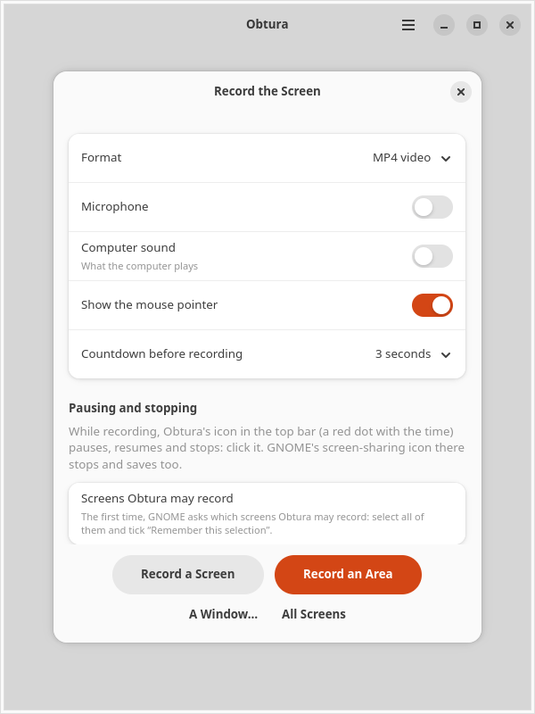

**Record** (start window, **Ctrl+Shift+E**, or the editor's main menu) opens the Record
window:

| Setting | Choices |
| --- | --- |
| **Format** | MP4 video (plays everywhere), WebM video, Animated GIF (no sound; for chats and web pages) |
| **Microphone** | Your voice; a bar beside it shows how loud it is |
| **Computer sound** | What the computer plays; a bar shows how loud |
| **Show the mouse pointer** | On or off |
| **Countdown** | None, 3, 5 or 10 seconds |
| **GIF frames per second**, **GIF size** | Fewer frames and a smaller size make a smaller file |

Then **Record an Area** (drag over it, as for a screenshot; a click on a screen takes
all of it) or **Record a Screen**, which records the whole screen the Record window is
on. (Started from the command line, `obtura --record --screen` lets you click the
screen to record when there are several.) Below them:

- **A Window…**: GNOME lists the open windows; pick one. The recording follows that
  window wherever it goes; it keeps the size the window had at the start (a window made
  bigger is fitted in, with black borders).
- **All Screens**: every screen shared with Obtura, side by side in one video, as they
  are arranged.

The level bars beside **Microphone** and **Computer sound** show the sound live while
the Record window is open, so a muted microphone is seen before recording. Nothing is
recorded until you start.

### Pausing and stopping

While recording, Obtura's icon in the top bar shows a red dot and the time. Click it
for **Pause Recording**, **Resume Recording**, **Stop and Save** and **Discard…**. Also:

- GNOME's screen-sharing icon in the top bar stops and saves.
- Opening Obtura again (from the dock or the app grid) pauses and shows the controls.
- Running `obtura --record` again stops and saves.

The paused time is left out of the file.

### After recording

The **Recording saved** window shows the name, length and size of the file, with
**Open**, **Show in Files**, **Copy** (to paste the file in a chat or a folder), **Trim…**
and **Delete** (to the wastebasket). Recordings go to **Videos › Screencasts**, named by
the date and time.

### Trim

**Trim…** shows the first and the last picture kept. Move **Start** and **End** (the
arrow keys move them a tenth of a second at a time) and click **Trim**. The trimmed
recording takes the original's place; the original goes to the wastebasket.

### Good to know

- An area is recorded on one screen: the one holding most of it. To record several
  screens, use **All Screens**.
- GNOME does not let programs see clicks in other windows, so recordings cannot show
  click ripples.
- MP4 needs an H.264 encoder and Trim needs one more GStreamer package; both come with
  Obtura when installed from the Terminal. Obtura says what to install if one is missing.

---

## 11. The library

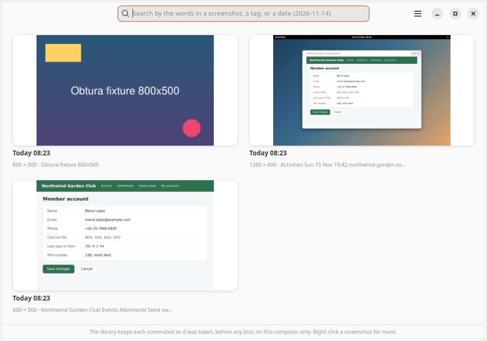

Every screenshot is kept in the library (**Ctrl+L**, start window, or the editor's main
menu): the picture as it was taken and, after you save, its marks too.

- **Search** by any word in the picture (its text is read in the background), by a tag,
  or by a date such as *2026-11-15*. Every word must match; capitals and accents do not
  matter (*ete* finds *Été*).
- **Click** a screenshot to open it in the editor again, with its marks.
- **Right-click** for **Open for Editing**, **Copy**, **Pin to Screen**, **Tags…**,
  **Keep Always**, **Show in Files** and **Delete…**.
- **Tags…**: words of your own to find a screenshot by (*invoice, bug 42*), separated by
  commas; tags used before are one click away. They show under the screenshot.

The library keeps each screenshot **as it was taken, before any blur**, so that it can
be edited again. It stays on this computer, in `~/.local/share/obtura/library`. If that
is not what you want, Preferences can turn the library off, or remove screenshots after
a number of days (those marked **Keep Always** stay). The search never finds what you
hid in a saved picture: after a save, the text is read again from the saved picture.

---

## 12. The command line

Every capture can be started from a Terminal, a script or a keyboard shortcut.

| Command | What it does |
| --- | --- |
| `obtura --region` | Choose a region, then open the editor |
| `obtura --screen` | The whole screen |
| `obtura --last-region` | The region chosen last time, without asking |
| `obtura --window` | A window, picked in GNOME's list |
| `obtura --scroll` | Scrolling capture; run it again to finish |
| `obtura --region --delay 5` | Wait 5 seconds first (0 to 30) |
| `obtura --region --copy` | Copy to the clipboard, no editor |
| `obtura --screen --save ~/shot.png` | Save to a file, no editor (no path: the save folder) |
| `obtura --ocr` | Copy and print the text of a region |
| `obtura --qr` | Copy and print what the QR codes of a region hold |
| `obtura --pick-color` | Copy and print a colour from the screen |
| `obtura --measure` | Measure on the screen; Enter copies and prints it |
| `obtura --pin` | Pin a region on the screen |
| `obtura --record` | Record an area; run it again to stop (`--screen`: a whole screen; `--window`: a window; `--all-screens`: every screen) |
| `obtura --library` | Open the library |
| `obtura --help`, `obtura --version` | The options, the version |

The **exit status** says how it went: **0** done, **1** failed (or no text or code
found), **2** wrong options, **3** cancelled. `--copy`, `--ocr`, `--qr`, `--pick-color`
and `--measure` keep Obtura running in the background once they have copied something,
which keeps the clipboard: in a script, start them with `&`.
`man obtura` has the details.

---

## 13. Preferences

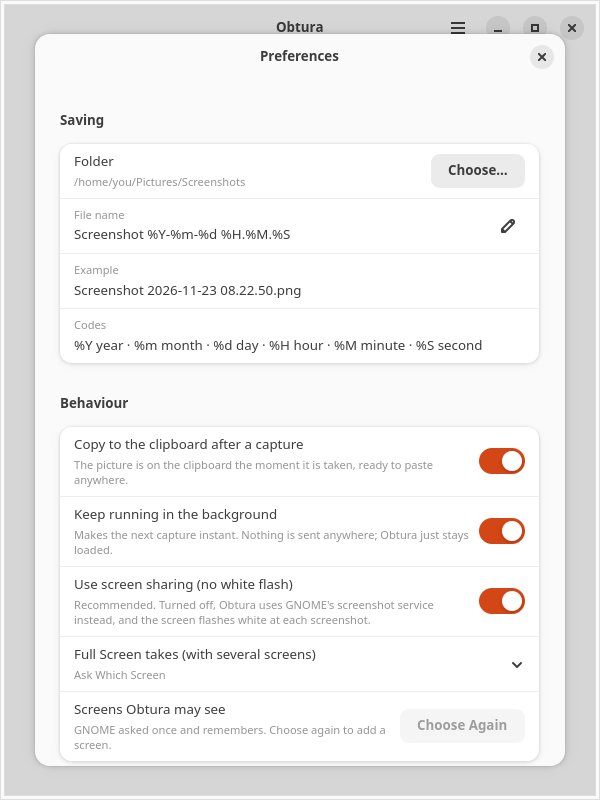

**Preferences** (**Ctrl+,**) are saved as soon as you change them.

| Group | Settings |
| --- | --- |
| **Saving** | The folder for pictures; the file name, with codes for the date and time (`%Y` year, `%m` month, `%d` day, `%H` hour, `%M` minute, `%S` second) and an example |
| **Behaviour** | Copy to the clipboard after a capture; keep running in the background (the next capture is instant); use screen sharing (no white flash); the screens Obtura may see |
| **Library** | Keep every screenshot; read their text for the search; remove screenshots older than a number of days (0 keeps all) |
| **Text reading** | The languages to read, for example `eng+fra`; empty uses those installed |
| **Colour picker** | Copy colours as `#rrggbb`, `rgb(r, g, b)` or `hsl(h, s%, l%)` |
| **Recording** | The folder and file name of recordings |
| **Keys that work in every app** | Super+Shift+S, Super+Shift+T and Super+Shift+R, added to GNOME's keyboard shortcuts (off: removed) |
| **Other keys** | More commands to bind to a key, each with a copy button |

**Use screen sharing (no white flash)** (on, recommended): Obtura looks at the screen
the way screen sharing does. Turned off, Obtura uses GNOME's screenshot service, and the
screen flashes white at each screenshot.

To read text in other languages, install them, for example French and German:
`sudo apt install tesseract-ocr-fra tesseract-ocr-deu`.

---

## 14. Keyboard shortcuts

**Ctrl+?** (or **Ctrl+F1**) shows them all in Obtura. On many keyboards **?** needs
**Shift**: on a French keyboard, Ctrl+? is **Ctrl+Shift+,**.

| In every app (once turned on) | |
| --- | --- |
| Capture a region | **Super+Shift+S** |
| Copy the text of a region | **Super+Shift+T** |
| Start or stop recording an area | **Super+Shift+R** |

| Capture | |
| --- | --- |
| Select a region | **Ctrl+Shift+R** |
| Whole screen | **Ctrl+Shift+F** |
| Copy the text of a region | **Ctrl+Shift+T** |
| New screenshot / same region, from the editor | **Ctrl+N** / **Ctrl+Shift+N** |
| Scrolling capture | Start window, **Scrolling** beside **New**, `obtura --scroll` |
| Record the screen | **Ctrl+Shift+E** |
| Library | **Ctrl+L** |

| In the region overlay | |
| --- | --- |
| Take the picture | **Enter** or double-click |
| Move / resize the selection by one pixel | **Arrow keys** / **Shift+arrow keys** |
| Choose the shared screens again | **S** |
| Cancel | **Escape** or right-click |

| Editing | |
| --- | --- |
| Tools | **V L S R E P H T K N M D Z B X O C U G I Q** |
| Format | **F** |
| Beautify | **Shift+B** |
| Undo / Redo | **Ctrl+Z** / **Ctrl+Shift+Z** |
| Delete the selected mark | **Delete** |
| Back out one step | **Escape** |
| Apply the crop | **Enter** |
| Square, circle, 45° lines | **Shift** while drawing |
| Move without snapping | **Alt** while moving |
| Paste a picture, or text as a text box | **Ctrl+V** |
| Turn the selected mark | Drag its round handle (**Shift**: 15° steps) |
| Add / remove a bend (with **V**) | Double-click the line / the bend |
| Read the QR codes in the picture | **Ctrl+Shift+Q** |
| Rotate left / right | **Ctrl+[** / **Ctrl+]** |
| Resize the picture | **Ctrl+Alt+R** |
| Copy all the text in the picture | **Ctrl+Shift+C** |
| Smart Redact | **Ctrl+Shift+X** |
| Pin to the screen | **Ctrl+Shift+P** |

| View and file | |
| --- | --- |
| Zoom in / out | **Ctrl+wheel**, **Ctrl++**, **Ctrl+-** |
| Fit to window / actual size | **Ctrl+0** / **Ctrl+1** |
| Copy / Save / Save As | **Ctrl+C** / **Ctrl+S** / **Ctrl+Shift+S** |
| Close | **Ctrl+W** |
| Preferences / Keyboard shortcuts / User guide | **Ctrl+,** / **Ctrl+?** or **Ctrl+F1** / **F1** |

---

## 15. Troubleshooting

**The screen is dark in the region overlay, or one screen is** — GNOME does not share
that screen with Obtura. Press **S** and select every screen in GNOME's window, with
**Remember this selection** ticked. Or use **Preferences › Screens Obtura may see ›
Choose Again**.

**GNOME's screen-sharing icon appears after a screenshot** — that is how Obtura avoids
GNOME's white flash. It goes after a few seconds. To use GNOME's screenshot service
instead (with the flash), turn off **Preferences › Use screen sharing (no white flash)**.

**"Screenshots are not allowed"** — GNOME was told not to let Obtura take screenshots.
Click **Ask Again**, then **Allow** in GNOME's question.

**"Text reading is not installed"** — install Tesseract:

```
sudo apt install tesseract-ocr tesseract-ocr-eng
```

**"Recording needs GStreamer's tools"**, or MP4 is not available, or Trim cannot cut —
install the GStreamer packages:

```
sudo apt install gstreamer1.0-tools gstreamer1.0-pipewire gstreamer1.0-plugins-good gstreamer1.0-plugins-ugly gstreamer1.0-plugins-bad gstreamer1.0-libav
```

**I do not see Obtura's icon in the top bar while recording** — Ubuntu shows it with its
AppIndicator extension (on by default). Without it, Obtura shows a notification with a
**Stop** button; opening Obtura again also pauses and shows the controls.

**The shortcut key does nothing** — Obtura's own keys (**Ctrl+Shift+R**…) work only
while an Obtura window is in front; turn on **Preferences › Keys in every app** for
keys that work everywhere. For a key of your own, check the command in **Settings ›
Keyboard › Custom Shortcuts** (copy it from Obtura's Preferences), and that no other
shortcut uses the same key.

**A scrolling capture says "Too fast", or parts are missing** — scroll more slowly (one
wheel notch at a time is safe) and scroll back up until the height shows again. Pages
where most of the view moves by itself (a video, a slideshow) can confuse the joining:
select only the part that scrolls. Pages join best scrolled with the wheel, not by
dragging the scroll bar (a drag can jump further than one view). Obtura's log
(main menu › **Show Log File**) says after each scrolling capture how many views were
joined and how many did not overlap.

**The microphone indicator shows while the Record window is open** — that is the level
bar listening, so you can see the microphone works. Turn **Microphone** off, or close the
Record window, and it stops.

**Emoji show as plain symbols** — install the colour emoji font:
`sudo apt install fonts-noto-color-emoji`.

**Reset Obtura to its defaults** — close Obtura, then in a Terminal:
`mv ~/.config/obtura ~/.config/obtura.old` (your library is elsewhere and is not
affected).

**The log file** — Obtura writes down what goes wrong (errors, warnings and crashes) in
`~/.local/state/obtura/obtura.log`, so you do not have to describe it. **Show Log File**
in the main menu opens its folder. The log holds the time, the version, your Ubuntu
version and the error messages. It never holds your pictures, the text read from them,
what you typed on them or your clipboard, and it never leaves your computer. It is
kept to about 1 MB (the one before is `obtura.log.1`); delete the files whenever you like.

**Report a problem** — choose **Report a Problem…** in the main menu to open the
[issue tracker](https://github.com/Romi-iubh/obtura/issues). Say what you did, what you
expected and what happened, and attach `obtura.log` (read it first: it is plain text).
Check that a screenshot you attach shows nothing private.

---

## 16. Your data and privacy

Obtura works entirely on your computer. It never connects to the internet, has no
account, shows no advertising and collects nothing.

| Where | What |
| --- | --- |
| `~/Pictures/Screenshots/` | Saved pictures (or the folder you chose) |
| `~/Videos/Screencasts/` | Recordings (or the folder you chose) |
| `~/.local/share/obtura/library/` | The library: each capture as it was taken, its text, its tags, the marks of the last save |
| `~/.local/share/obtura/backgrounds/` | Pictures you chose as a Beautify background (a copy, so the frame keeps working if the original moves) |
| `~/.config/obtura/settings.json` | Preferences, tool styles, your frame |
| `~/.local/state/obtura/` | The last region chosen; the screens GNOME lets Obtura see; the log file `obtura.log` |
| `~/.cache/obtura/` | The parts of a recording or of a scrolling capture under way, removed when it ends |

Updating or removing Obtura never touches these folders. To delete the library, use
**Delete…** on each screenshot, or remove the folder while Obtura is closed.

Text is read by the Tesseract program on your computer, QR codes by Obtura itself;
recordings are made by GStreamer on your computer. Screen sharing is only used while Obtura takes a picture or
records, and GNOME shows its icon whenever it is in use.

---

## 17. Licence and credits

Obtura is free software: you may use, study, share and change it under the terms of the
GNU Affero General Public License, version 3 or later. The source code is at
<https://github.com/Romi-iubh/obtura>.

Obtura is written in Rust with GTK 4 and libadwaita, and draws with cairo and Pango.
It records with GStreamer, reads text with Tesseract and QR codes with rqrr. The licences of the libraries
built into Obtura are in **About › Legal** and in
`/usr/share/doc/obtura/THIRD-PARTY-LICENSES.txt`.

© 2026 Rosaire.

---

## 18. Obtura on Windows

Obtura runs on Windows 10 and Windows 11 (64-bit). Everything in this guide works the
same way, except what this section lists. Where the guide says "GNOME" or "the top bar",
read "Windows" and "the notification area" (the icons by the clock).

### Install

1. Download `Obtura-0.9.1-setup.exe`.
2. Double-click it. If Windows says **Windows protected your PC** (the installer is not
   signed by a company), click **More info**, then **Run anyway**.
3. Click **Next** until **Finish**. Obtura is installed for you only, in
   `AppData\Local\Programs\Obtura`; no administrator password is needed. Two choices on
   the way: start Obtura in the background when you sign in (on: Print Screen then works
   at once), and a shortcut on the desktop (off).

Obtura is then in the Start menu. To run it without installing, unpack
`Obtura-0.9.1-windows-x64.zip`, open the folders **Obtura**, then **bin**, and
double-click **obtura.exe** (keep the folders together).

**Update**: run the new installer. **Remove**: Windows **Settings › Apps › Installed
apps › Obtura › Uninstall**. Your settings, your library and your saved pictures are kept.

### Print Screen and Obtura's icon

| Key | What it does |
| --- | --- |
| Print Screen | Capture a region |
| Shift+Print Screen | Copy the text of a region |
| Ctrl+Print Screen | Capture the whole screen |

These keys work in every app while Obtura runs. Once opened, Obtura stays running with
its icon in the notification area: click the icon to capture a region, right-click it
for the other captures, the library, Preferences and **Quit Obtura**. Windows may hide
the icon under the **^** arrow by the clock; drag it onto the taskbar to keep it in view.
**Preferences › Keys that work in every app** turns the keys off.

**Windows 11 gives Print Screen to its Snipping Tool.** To give it to Obtura, open
Windows **Settings › Accessibility › Keyboard** and turn off **Use the Print screen key
to open screen capture**. Obtura's start window says so, with a button that opens that
page.

### What is different

- **No question, no flash.** Windows lets Obtura read the screen directly: the first
  capture does not ask anything, and the screen never flashes.
- **A window** (New › A Window…): Obtura captures the window you were using, the one in
  front of the others. Click that window first, then use the menu of Obtura's icon or
  the New button.
- **Scrolling capture**: to finish, press **Print Screen** again, or click Obtura's
  icon. A message by the clock says so when the capture starts.
- **Pins** stay above the other windows; right-click a pin, **Keep Above Other Windows**,
  to let it go back among them.
- **Recording the screen is not available on Windows yet.** Windows' own Snipping Tool
  records the screen: press **Win+Shift+R**.
- **Text reading** comes with Tesseract and the English language. For another language,
  download its `.traineddata` file from <https://github.com/tesseract-ocr/tessdata> into
  `AppData\Local\Programs\Obtura\share\tessdata`, then name it in **Preferences ›
  Text reading**.
- **Command line**: the options of [The command line](#12-the-command-line) work, apart
  from `--record` (`--window` takes the window in front), with the full path of the program:
  `"%LOCALAPPDATA%\Programs\Obtura\bin\obtura.exe" --region`. **Preferences › Other
  keys** shows each command ready to copy, and how to give it a key of its own.

### Where Obtura keeps things on Windows

| Where | What |
| --- | --- |
| `Pictures\Screenshots` | Saved pictures (or the folder you chose) |
| `%LOCALAPPDATA%\Obtura\Data\library` | The library |
| `%LOCALAPPDATA%\Obtura\Data\backgrounds` | Pictures chosen as a Beautify background |
| `%APPDATA%\Obtura\settings.json` | Preferences, tool styles, your frame |
| `%LOCALAPPDATA%\Obtura\State` | The last region chosen; the log file `obtura.log` |
| `%LOCALAPPDATA%\Obtura\Cache` | The parts of a scrolling capture under way |

Updating or removing Obtura never touches these folders.

Obtura for Windows comes with GTK, libadwaita, GLib, cairo, Pango, Tesseract and the
libraries they need (from the MSYS2 project), each under its own licence. The list is
in `share\doc\obtura\WINDOWS-COMPONENTS.txt` in Obtura's folder, the licence texts
in `share\licenses`.

